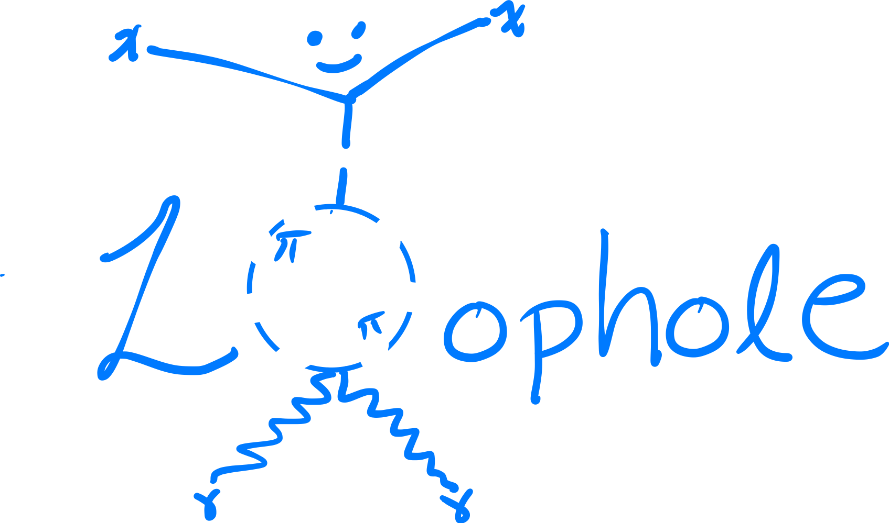

<p align="center">
  
</p>

# Loophole

Relic abundance and constraints for sub-GeV dark matter χ coupled to light quarks through a scalar, pseudoscalar or axial-vector mediator with a loop-induced photon coupling. This code is a public condensate of the software used to generate the data and figures in Avis Kozar, Cappiello, Diamond & Vincent (arXiv:xxxx.xxxxx), prepared using Claude Opus 5.5. 

## Which code

| task | use | notes |
|---|---|---|
| single points, checks, new physics | MATLAB | reference implementation; every observable and constraint; slowest |
| 2-D scans in (m_χ, g_q) at fixed m_φ, g_χ, ĝ | MATLAB `compare_limits_g.m` | paper's g_q figures; relic loci by root-finding, constraint curves overlaid |
| fast relic / ΔN_eff / σ_χN evaluation | Julia `Loophole` | same physics core, validated against MATLAB (`test/runtests.jl`) |
| global scans over (m_χ, m_φ, g_χ, g_u, g_d, g_s) | GAMBIT-light + Julia worker | likelihood = relic abundance only |
| constraints on scan output, plots | Python `analysis/` | applies every exclusion (kaon, CMB, meson → invisible, SN, stellar, …) to GAMBIT samples |

- The constraints are implemented in MATLAB and in Python (`analysis/`), cross-validated. The Julia port covers relic abundance, ΔN_eff and σ_χN.
- Adding physics: change MATLAB first, regenerate the Julia references (`test/matlab/dump_*.m`), then port.

## Physics

Per model point (m_χ, m_φ, g_χ, g = [g_u, g_d, g_s]):

| output | function |
|---|---|
| Ωh² | `freeze_loop` (m_φ > 50 T_RH) or `freeze_coupled` (m_φ ≤ 50 T_RH); T_RH = 10 MeV |
| ΔN_eff (CMB) | `neff_simple` |
| σ_χN | `DMnucxsec` |
| exclusion ratios | K⁺ → π⁺χχ̄, K⁺ → π⁺φ, π⁰/η/η′ → invisible, CMB, INTEGRAL, SN1987A, stellar, neutron star, fifth force, Bullet Cluster, axial-vector bounds |

| interaction | φ–χχ | φ–SM |
|---|---|---|
| `heavyScalar`, `lightScalar` (S⊗S) | scalar | scalar |
| `heavyScalarPS`, `lightScalarPS` (P⊗S) | pseudoscalar | scalar |
| `heavyScalarSP`, `lightScalarSP` (S⊗P) | scalar | pseudoscalar |
| `scalarPP`, `heavyScalarPP`, `lightScalarPP` (P⊗P) | pseudoscalar | pseudoscalar |
| `axialVector` (A⊗A) | axial vector | axial vector |

- `heavy`/`light` prefix does not affect the relic calculation.
- `axialVector`: `mphi` = m_A′, `gx` = λ_χ, `g` = [a_u, a_d, a_s].
- Units: GeV.
- Three-body channels (off by default): `LOOP_3PI=1` (χχ̄ → 3π, φ → 3π), `LOOP_PIPIPHI=1` (χχ̄ → ππφ; π⁺π⁻A′ for A⊗A). Read by MATLAB, Julia, the GAMBIT worker and the Python CMB bound.

### Which relic solver

| case | solver | why |
|---|---|---|
| m_φ > 50·T_RH (0.5 GeV at default T_RH) | `freeze_loop` | φ is Boltzmann-suppressed; evolve Y_χ only, φ enters as an s-channel propagator |
| m_φ ≤ 50·T_RH | `freeze_coupled` | on-shell φ is produced in the bath; evolve Y_χ and Y_φ together (also returns Ω_φh²) |
| quick freeze-in estimate | `Oh2_FI` | linearised integral; freeze-in branch only |
| quick freeze-out estimate | `freeze_out` | starts from equilibrium; freeze-out branch only |

- `freeze_loop` and `freeze_coupled` start from Y = 0 at T_RH and cover freeze-in, freeze-out and the transition. Use them for Ωh².
- `model_observables` (MATLAB, Julia), `compare_limits_g.m` and the GAMBIT worker choose between them automatically. Call a solver directly only to cross-check.
- Details: `docs/boltzmann_solvers.md`.

## Layout

```
matlab/          reference implementation; g_q scan figures (compare_limits_g.m)
julia/Loophole/  Julia port of the physics core; tests against MATLAB references
gambit/          GAMBIT-light library (C++), Julia worker, one YAML per model
analysis/        postprocess and plot GAMBIT scans (Python)
data/            digitised external limits
docs/            implementation notes
```

## Requirements

- MATLAB R2020a or later (developed on R2024a); no toolboxes required. Parallel Computing Toolbox optional (`parfor`).
- Julia ≥ 1.10.
- Python ≥ 3.10: `pip install -r analysis/requirements.txt`.
- GAMBIT-light (<https://github.com/GambitBSM/gambit_light>) with MPI and Diver; scans only.

## MATLAB

Single point:

```matlab
cd matlab
obs = model_observables(0.05, 0.1, 0.01, [2 -1 -1]*1e-6, 'heavyScalarPS');
obs.Oh2, obs.dNeff_cmb, obs.sigma_chiN
```

g_q scan figures: `compare_limits_g.m` fixes g_χ and a direction ĝ, scans g = g_q·ĝ and m_χ, and plots relic loci and exclusions in (m_χ, g_q) and (m_χ, σ_χN).

```bash
cd matlab
matlab -batch "set(0,'DefaultFigureVisible','off'); run_figure_sets_g"      # 5 families × m_φ ∈ {1e-9, 0.1, 1} GeV, g_χ = 0.01, ĝ = (2,−1,−1)
matlab -batch "set(0,'DefaultFigureVisible','off'); run_figure_sets_g_mfv"  # S⊗S, P⊗S, MFV quark couplings
```

- Output: PDFs in `matlab/figures_g/`, `matlab/figures_g_mfv/`; curves (`.dat`, `.mat`) in `matlab/output/`.
- Full set: several hours. Subset: edit `RUNSET.families`, `RUNSET.mphi_vec`.
- Options: header of `compare_limits_g.m`.

## Julia

```bash
cd julia/Loophole
julia --project=. -e 'using Pkg; Pkg.instantiate()'
julia --project=. -e 'using Loophole;
    m = model_from_interaction("heavyScalarPS", 0.05, 0.1, 0.01, [2.0, -1, -1] .* 1e-6);
    println(model_observables(m))'
julia --project=. test/runtests.jl                # vs MATLAB references (~3 min)
```

References: `test/ref/*.csv`, written by `test/matlab/dump_*.m`.

## GAMBIT-light scans

6-D scans over (m_χ, m_φ, g_χ, g_u, g_d, g_s). GAMBIT-light → C++ library (`gambit/cpp`) → persistent Julia process (`gambit/worker/worker.jl`, stdin/stdout). Scan likelihood = relic abundance only; all other constraints are applied in `analysis/postprocess.py`.

1. **Build** (`GAMBIT_LIGHT_DIR` set):
   ```bash
   gambit/build.sh                 # -> gambit/cpp/loop_loglike.so
   gambit/build_sysimage.sh        # optional: Julia sysimage
   ```
   - Use GAMBIT-light's C++ compiler (`build.sh` reads its CMakeCache).
   - Diver abort with no discrete parameters: apply `gambit/patches/diver_discrete_data.patch` to `diver.cpp` by hand.

2. **Configure** (from the repository root):
   ```bash
   export LOOP_JULIA_BIN=julia
   export LOOP_JULIA_PROJECT=$PWD/julia/Loophole
   export LOOP_WORKER_JL=$PWD/gambit/worker/worker.jl
   export LOOP_JULIA_SYSIMAGE=$PWD/gambit/loopabundance_sys.so   # if built
   ```
   - Set `user_lib:` in the YAML to the absolute path of `gambit/cpp/loop_loglike.so`.
   - Worker test: `julia --project=julia/Loophole gambit/worker/worker.jl`, input `axialVector 0.05 1e-9 1e-10 2e-10 2e-10 2e-10 0.01 0.3`.

3. **Run:**
   ```bash
   mpirun -n <N> $GAMBIT_LIGHT_DIR/gambit -f gambit/yaml/loophole_heavyScalar_relic.yaml
   ```
   Output: `runs/<model>_relic/samples/*.hdf5`.

4. **Postprocess, plot:**
   ```bash
   POSTPROC_RELIC_MU=0.12 POSTPROC_RELIC_SIGMA=0.012 \
       python analysis/postprocess.py runs/heavyScalar_relic/samples/heavyScalar_relic.hdf5 data
   python analysis/plot_all_constraints.py runs/heavyScalar_relic/samples/heavyScalar_relic.hdf5 data
   python analysis/dd/plot_sigma_mx_ddproj.py runs/heavyScalar_relic/samples/heavyScalar_relic_postprocessed.hdf5   # m_φ = 10 GeV: DD overlay
   ```
   - Plots: `analysis/plots/<tag>_allconstraints/`, `<tag>_ddproj/`.
   - `postprocess.py` writes `*_postprocessed.hdf5` with `LogLike_<constraint>` and `excluded_<constraint>` per bound. Bound strengths: environment variables at the top of the file.
   - DD overlay: run `analysis/dd/fetch_si_limits.sh` once.

**Paper variants.**
- Heavy mediator: `p2: {name: mphi, fixed_value: 10.0}`; remove mphi from `initial_guesses`.
- MFV: one master coupling, g = g_q·[m_u, m_d, m_s]/(m_u + m_d + m_s):
  ```yaml
  p4: {name: gq, prior_type: log, range: [1.0e-12, 1.0]}
  p5: {name: gu, same_as: UserModel::p4, scale: 0.02159191284718814}
  p6: {name: gd, same_as: UserModel::p4, scale: 0.04603003238786926}
  p7: {name: gs, same_as: UserModel::p4, scale: 0.9323780547649425}
  ```
  Renumber fixed entries (`T_RH`, `s_mix`, …) from `p8`; `initial_guesses` = (mx, mphi, gx, gq).
- Set `output_file` and `default_output_path` per variant.

## Docs

| file | topic |
|---|---|
| `docs/boltzmann_solvers.md` | relic solvers, dispatch |
| `docs/cross_sections.md` | BW, detailed balance, pole couplings, three-body channels |
| `docs/axialvector.md` | axial-vector model, EFT validity |
| `docs/mediator_width.md` | widths, mφ = 0 guards |
| `docs/dmnucxsec.md` | σ_χN |
| `docs/kaon_constraint.md` | K⁺ → π⁺χχ̄ |
| `docs/mesonandCMB_constraints.md` | K → πφ, CMB, INTEGRAL, meson → invisible |
| `docs/phi_thermalisation_check.md` | πγ → πφ, Primakoff |
| `data/README.md` | external limit sources |

## Citation and licence

Cite the accompanying paper (`CITATION.cff`). MIT licence (`LICENSE`). External limits: see `data/README.md`.
